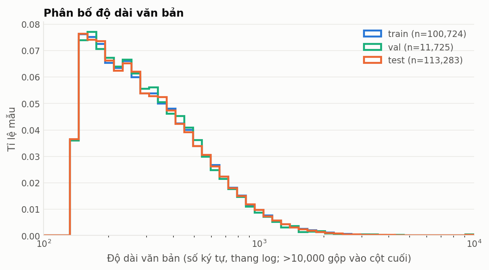
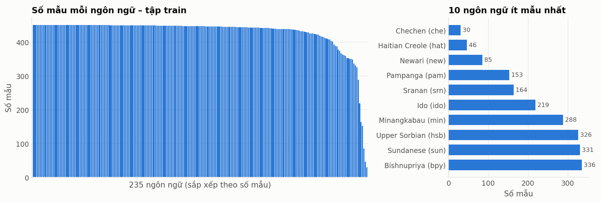
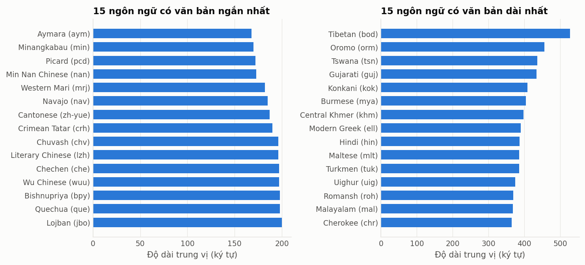
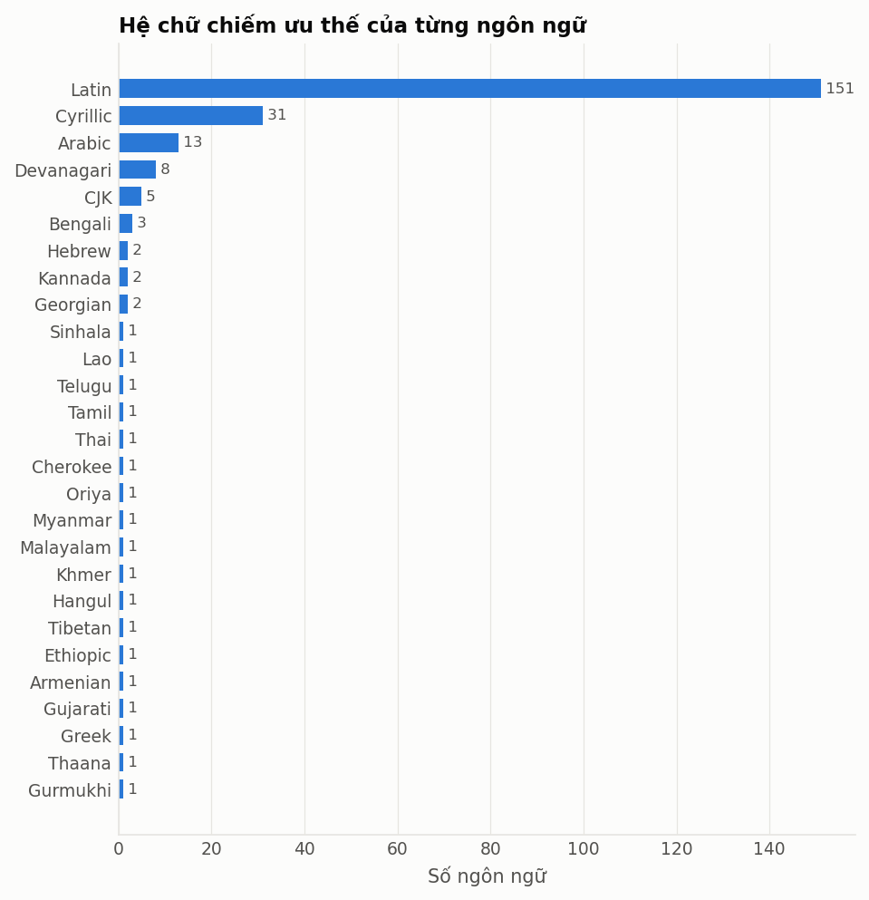

# EDA WiLI-2018 (processed)

## Tổng quan

| Tập | Số mẫu | Số ngôn ngữ | Mẫu/ngôn ngữ (min–max) | Trùng lặp exact | Không ở dạng NFC |
|---|---:|---:|---:|---:|---:|
| train | 100,724 | 235 | 30–450 | 0 | 0 |
| val | 11,725 | 235 | 29–50 | 0 | 0 |
| test | 113,283 | 235 | 66–500 | 0 | 0 |

- Số dòng train trùng y hệt một dòng test: **0**
- Số đoạn văn bị gán nhiều nhãn khác nhau: **0**

## Độ dài văn bản (số ký tự)

| Tập | min | p5 | median | mean | p95 | max |
|---|---:|---:|---:|---:|---:|---:|
| train | 140 | 148 | 275 | 374 | 879 | 40,578 |
| val | 140 | 148 | 275 | 371 | 848 | 34,656 |
| test | 140 | 148 | 274 | 377 | 878 | 195,402 |

| Tập | 0-199 | 200-499 | 500-999 | 1000-4999 | >=5000 |
|---|---:|---:|---:|---:|---:|
| train | 28.1% | 52.5% | 15.9% | 3.4% | 0.1% |
| val | 27.8% | 53.6% | 15.4% | 3.0% | 0.1% |
| test | 28.2% | 52.5% | 15.9% | 3.4% | 0.1% |

## Ngôn ngữ ít mẫu nhất (tập train)

| Mã | Tên | Số mẫu |
|---|---|---:|
| che | Chechen | 30 |
| hat | Haitian Creole | 46 |
| new | Newari | 85 |
| pam | Pampanga | 153 |
| srn | Sranan | 164 |
| ido | Ido | 219 |
| min | Minangkabau | 288 |
| hsb | Upper Sorbian | 326 |
| sun | Sundanese | 331 |
| bpy | Bishnupriya | 336 |

## Độ dài trung vị theo ngôn ngữ

| Ngắn nhất | median | Dài nhất | median |
|---|---:|---|---:|
| Aymara (aym) | 168 | Tibetan (bod) | 527 |
| Minangkabau (min) | 170 | Oromo (orm) | 456 |
| Picard (pcd) | 172 | Tswana (tsn) | 436 |
| Min Nan Chinese (nan) | 173 | Gujarati (guj) | 434 |
| Western Mari (mrj) | 182 | Konkani (kok) | 408 |
| Navajo (nav) | 185 | Burmese (mya) | 404 |
| Cantonese (zh-yue) | 187 | Central Khmer (khm) | 398 |
| Crimean Tatar (crh) | 190 | Modern Greek (ell) | 390 |
| Chuvash (chv) | 196 | Hindi (hin) | 386 |
| Literary Chinese (lzh) | 196 | Maltese (mlt) | 386 |

## Hệ chữ chiếm ưu thế (số ngôn ngữ)

| Hệ chữ | Số ngôn ngữ |
|---|---:|
| Latin | 151 |
| Cyrillic | 31 |
| Arabic | 13 |
| Devanagari | 8 |
| CJK | 5 |
| Bengali | 3 |
| Hebrew | 2 |
| Kannada | 2 |
| Georgian | 2 |
| Lao | 1 |
| Telugu | 1 |
| Tamil | 1 |
| Sinhala | 1 |
| Gurmukhi | 1 |
| Oriya | 1 |
| Myanmar | 1 |
| Malayalam | 1 |
| Khmer | 1 |
| Hangul | 1 |
| Tibetan | 1 |
| Ethiopic | 1 |
| Armenian | 1 |
| Gujarati | 1 |
| Greek | 1 |
| Thaana | 1 |
| Cherokee | 1 |
| Thai | 1 |

## Họ ngôn ngữ (10 họ lớn nhất)

| Họ | Số ngôn ngữ |
|---|---:|
| Indo-European | 122 |
| Austronesian | 22 |
| Turkic | 17 |
| Uralic | 14 |
| Niger-Congo | 11 |
| Sino-Tibetan | 10 |
| Afro-Asiatic | 9 |
| Constructed | 6 |
| Dravidian | 5 |
| Northeast Caucasian | 4 |

## Hình

