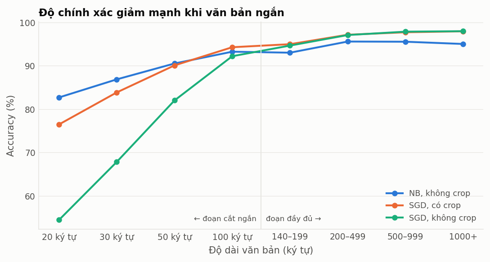
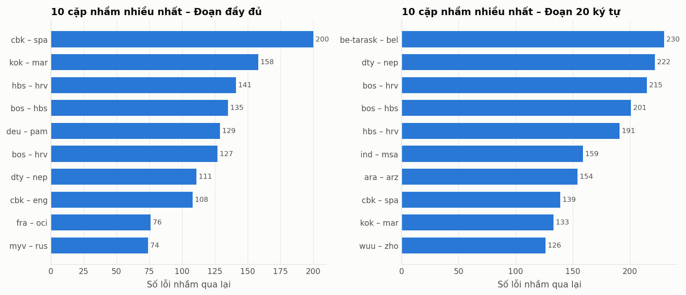

# Phân tích lỗi theo độ dài và cặp ngôn ngữ

Cấu hình chính: `char_wb_1_4_100k__nb__nocrop`. Tập test: 113,283 đoạn đầy đủ; các nhóm "N ký tự" là chính các đoạn đó được cắt ngắn còn khoảng N ký tự (data/augment.py).

## Độ chính xác theo độ dài

| Nhóm | Số mẫu | NB, không crop | SGD, có crop | SGD, không crop |
|---|---:|---:|---:|---:|
| 20 ký tự | 113,283 | 82.7% / 82.9% | 76.5% / 76.8% | 54.5% / 62.6% |
| 30 ký tự | 113,283 | 86.9% / 87.1% | 83.9% / 84.0% | 67.8% / 73.9% |
| 50 ký tự | 113,283 | 90.5% / 90.7% | 90.1% / 90.1% | 82.0% / 84.7% |
| 100 ký tự | 113,283 | 93.2% / 93.5% | 94.3% / 94.3% | 92.2% / 92.5% |
| 140–199 | 31,934 | 93.0% / 93.1% | 95.0% / 94.4% | 94.7% / 94.1% |
| 200–499 | 59,436 | 95.6% / 95.5% | 97.2% / 97.0% | 97.1% / 97.0% |
| 500–999 | 18,011 | 95.5% / 94.0% | 97.7% / 97.4% | 97.9% / 97.7% |
| 1000+ | 3,902 | 95.0% / 91.4% | 98.0% / 96.6% | 98.0% / 97.5% |
| Toàn bộ test | 113,283 | 94.8% / 95.0% | 96.7% / 96.7% | 96.6% / 96.6% |

Mỗi ô: accuracy / macro-F1.

## Cặp ngôn ngữ hay bị nhầm – đoạn đầy đủ

| Cặp | Lỗi a→b | Lỗi b→a | Tổng lỗi | Tỉ lệ | Cùng họ | Cùng hệ chữ |
|---|---:|---:|---:|---:|:---:|:---:|
| Chavacano (`cbk`) – Spanish (`spa`) | 198 | 2 | 200 | 20.0% | ✓ | ✓ |
| Konkani (`kok`) – Marathi (`mar`) | 156 | 2 | 158 | 15.9% | ✓ |  |
| Serbo-Croatian (`hbs`) – Croatian (`hrv`) | 76 | 65 | 141 | 14.2% | ✓ | ✓ |
| Bosnian (`bos`) – Serbo-Croatian (`hbs`) | 87 | 48 | 135 | 13.5% | ✓ | ✓ |
| German (`deu`) – Pampanga (`pam`) | 0 | 129 | 129 | 15.8% |  | ✓ |
| Bosnian (`bos`) – Croatian (`hrv`) | 88 | 39 | 127 | 12.8% | ✓ | ✓ |
| Doteli (`dty`) – Nepali (macrolanguage) (`nep`) | 73 | 38 | 111 | 11.3% | ✓ | ✓ |
| Chavacano (`cbk`) – English (`eng`) | 108 | 0 | 108 | 10.8% | ✓ | ✓ |
| French (`fra`) – Occitan (`oci`) | 1 | 75 | 76 | 7.6% | ✓ | ✓ |
| Erzya (`myv`) – Russian (`rus`) | 73 | 1 | 74 | 7.4% |  | ✓ |
| English (`eng`) – Igbo (`ibo`) | 0 | 67 | 67 | 6.7% |  | ✓ |
| Wu Chinese (`wuu`) – Standard Chinese (`zho`) | 39 | 26 | 65 | 6.5% | ✓ | ✓ |
| Indonesian (`ind`) – Banyumasan (`map-bms`) | 13 | 50 | 63 | 6.4% | ✓ | ✓ |
| Classical Nahuatl (`nci`) – Spanish (`spa`) | 62 | 0 | 62 | 6.2% |  | ✓ |
| Avar (`ava`) – English (`eng`) | 59 | 0 | 59 | 6.4% |  |  |

Tỉ lệ = tổng lỗi giữa hai ngôn ngữ / tổng số mẫu của cả hai. 67% trong 15 cặp đứng đầu thuộc cùng họ ngôn ngữ.

## Cặp ngôn ngữ hay bị nhầm – đoạn 20 ký tự

| Cặp | Lỗi a→b | Lỗi b→a | Tổng lỗi | Tỉ lệ | Cùng họ | Cùng hệ chữ |
|---|---:|---:|---:|---:|:---:|:---:|
| Belarusian (Taraschkewiza) (`be-tarask`) – Belarusian (`bel`) | 105 | 125 | 230 | 23.2% | ✓ | ✓ |
| Doteli (`dty`) – Nepali (macrolanguage) (`nep`) | 123 | 99 | 222 | 22.7% | ✓ | ✓ |
| Bosnian (`bos`) – Croatian (`hrv`) | 113 | 102 | 215 | 21.6% | ✓ | ✓ |
| Bosnian (`bos`) – Serbo-Croatian (`hbs`) | 101 | 100 | 201 | 20.2% | ✓ | ✓ |
| Serbo-Croatian (`hbs`) – Croatian (`hrv`) | 104 | 87 | 191 | 19.2% | ✓ | ✓ |
| Indonesian (`ind`) – Malay (`msa`) | 90 | 69 | 159 | 16.1% | ✓ | ✓ |
| Arabic (`ara`) – Egyptian Arabic (`arz`) | 69 | 85 | 154 | 15.4% | ✓ | ✓ |
| Chavacano (`cbk`) – Spanish (`spa`) | 110 | 29 | 139 | 13.9% | ✓ | ✓ |
| Konkani (`kok`) – Marathi (`mar`) | 132 | 1 | 133 | 13.4% | ✓ |  |
| Wu Chinese (`wuu`) – Standard Chinese (`zho`) | 77 | 49 | 126 | 12.6% | ✓ | ✓ |
| Indonesian (`ind`) – Banyumasan (`map-bms`) | 64 | 60 | 124 | 12.6% | ✓ | ✓ |
| Norwegian Nynorsk (`nno`) – Bokmål (`nob`) | 77 | 46 | 123 | 12.3% | ✓ | ✓ |
| Komi-Permyak (`koi`) – Komi (`kom`) | 59 | 49 | 108 | 11.1% | ✓ | ✓ |
| Danish (`dan`) – Bokmål (`nob`) | 44 | 57 | 101 | 10.1% | ✓ | ✓ |
| English (`eng`) – Scots (`sco`) | 26 | 74 | 100 | 10.0% | ✓ | ✓ |

Tỉ lệ = tổng lỗi giữa hai ngôn ngữ / tổng số mẫu của cả hai. 100% trong 15 cặp đứng đầu thuộc cùng họ ngôn ngữ.

## 10 ngôn ngữ có F1 thấp nhất – đoạn đầy đủ

| Ngôn ngữ | F1 | Số mẫu | Hay bị đoán thành |
|---|---:|---:|---|
| English (`eng`) | 38.3% | 500 | Scots (`sco`) |
| Chechen (`che`) | 48.3% | 66 | Lezghian (`lez`) |
| Chavacano (`cbk`) | 52.4% | 500 | Spanish (`spa`) |
| Pampanga (`pam`) | 68.9% | 316 | German (`deu`) |
| Serbo-Croatian (`hbs`) | 69.1% | 498 | Croatian (`hrv`) |
| German (`deu`) | 69.9% | 500 | French (`fra`) |
| Bosnian (`bos`) | 70.0% | 499 | Croatian (`hrv`) |
| Spanish (`spa`) | 72.7% | 499 | English (`eng`) |
| Konkani (`kok`) | 73.0% | 497 | Marathi (`mar`) |
| Croatian (`hrv`) | 73.2% | 494 | Serbo-Croatian (`hbs`) |

## 10 ngôn ngữ có F1 thấp nhất – đoạn 20 ký tự

| Ngôn ngữ | F1 | Số mẫu | Hay bị đoán thành |
|---|---:|---:|---|
| English (`eng`) | 31.5% | 500 | Scots (`sco`) |
| Chechen (`che`) | 35.0% | 66 | Lezghian (`lez`) |
| Pampanga (`pam`) | 42.4% | 316 | German (`deu`) |
| Chavacano (`cbk`) | 43.2% | 500 | Spanish (`spa`) |
| Bosnian (`bos`) | 46.2% | 499 | Croatian (`hrv`) |
| Serbo-Croatian (`hbs`) | 47.1% | 498 | Croatian (`hrv`) |
| Spanish (`spa`) | 47.8% | 499 | Chavacano (`cbk`) |
| Croatian (`hrv`) | 47.9% | 494 | Bosnian (`bos`) |
| Indonesian (`ind`) | 50.1% | 489 | Malay (`msa`) |
| Banyumasan (`map-bms`) | 52.5% | 497 | Indonesian (`ind`) |

## Ngưỡng độ tin cậy (`is_unsure`)

Mỗi ô: phần trăm dự đoán có confidence ≥ ngưỡng / độ chính xác của phần đó / độ chính xác của phần bị gắn cờ unsure.

| Nhóm | ≥ 0.4 | ≥ 0.6 | ≥ 0.8 | ≥ 0.9 |
|---|---|---|---|---|
| 20 ký tự | 92% / 87.6% / 24.8% | 82% / 92.6% / 37.9% | 71% / 96.2% / 49.0% | 64% / 97.7% / 55.7% |
| 30 ký tự | 96% / 89.7% / 23.9% | 88% / 93.5% / 38.5% | 79% / 96.4% / 50.7% | 73% / 97.6% / 58.0% |
| 50 ký tự | 98% / 91.9% / 23.1% | 93% / 94.5% / 38.8% | 87% / 96.5% / 51.9% | 82% / 97.4% / 59.8% |
| 100 ký tự | 99% / 93.7% / 24.3% | 97% / 95.1% / 39.8% | 93% / 96.4% / 52.1% | 90% / 97.2% / 59.4% |
| Toàn bộ test | 100% / 95.0% / 20.8% | 98% / 95.7% / 39.4% | 96% / 96.5% / 50.9% | 95% / 97.0% / 57.9% |

## Hình

